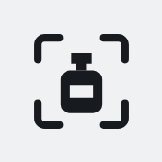
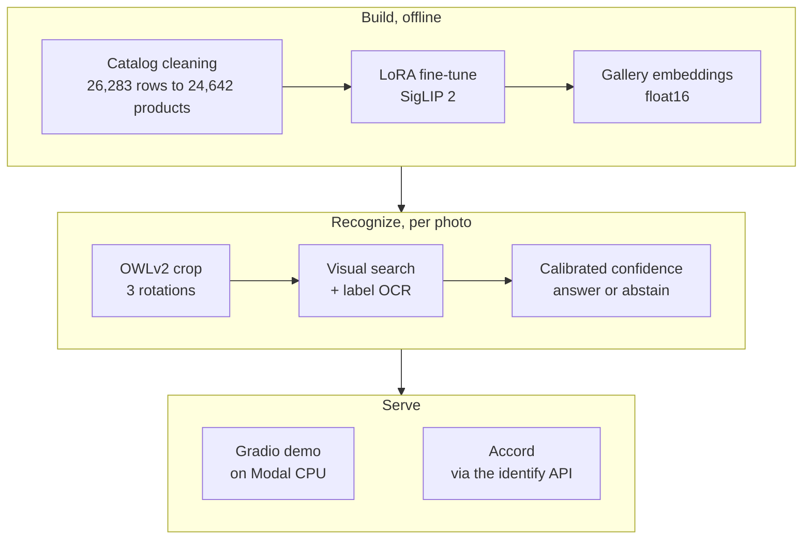
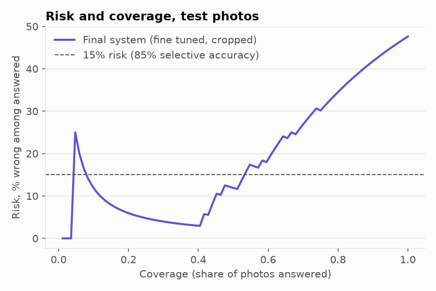

<p align="center"></p>

# ScentLens

**Names a fragrance from one photo of its bottle, out of 24,642 catalog fragrances, and says so when it isn't sure.** It is the bottle scanner inside [Accord](https://accord.bhanusadhu.com).

**[Try it → scentlens.bhanusadhu.com](https://scentlens.bhanusadhu.com)** · free; the first photo can take about 30 s while the server wakes up.

> **The live demo is paused right now.** It runs on a free hosting tier and this month's free credit is used up, so it returns when the credit resets. Until then that address shows a status page with the recorded demo, and the same recording is just below.


## The problem

You're holding a bottle at a friend's place or in a store, and you want to know exactly what it is. Image search returns similar-looking products, and the catalog's clean studio shots look nothing like a phone photo taken at an angle on a cluttered desk. Many look-alike flankers share a bottle shape, so a confident wrong answer is easy and costly: it sends you to the wrong fragrance.

The goal: **name the bottle when the evidence is strong, and say "not sure" otherwise.**

## How it works

1. **Find the bottle.** An open-vocabulary detector (OWLv2) boxes "a perfume bottle", widens the box 15% and crops it. The crop is tried at three rotations.
2. **Compare.** A SigLIP 2 image model, fine-tuned with LoRA on catalog images, embeds the crop and searches the embeddings of every catalog image.
3. **Read the label.** OCR reads the words on the bottle, and a text-match score is added to the visual one. A clear-label rule answers when every brand and name word of a guess is read and no other product matches them all.
4. **Decide or abstain.** A calibrated confidence decides whether to name it. Below the threshold it shows the top candidates and says it isn't sure.

## Product decisions

| Decision | Trade-off |
| --- | --- |
| **Abstain instead of guessing** | It answers only about a third of photos. Answers it does give were right on 28 of 30 test photos and all 14 fresh web photos it answered, which matters more than coverage for a lookup tool. |
| **Pre-register the evaluation, score the test once** | Slower, and some ideas were tested after the fact as a separate "version 2". But the headline number can't be tuned to the test photos. A CI test pins the pre-registration's hash so its original text can't be edited. |
| **Search a gallery instead of training a classifier** | Near-identical sibling bottles stay hard to tell apart. In return a new fragrance needs only its catalog image embedded, with no retraining. |
| **Swap the OCR engine without refitting** | The hosted version can't use macOS Vision, so it uses RapidOCR with every setting kept. Refitting for RapidOCR made guesses on look-alike siblings confident, so that refit was thrown away. |
| **Free CPU hosting** | One container, shut down after a few idle minutes, so the first photo waits for a cold start. Hugging Face Spaces now needs a paid plan for this, so it runs on Modal's free tier instead. |
| **Never loosen a safety filter after seeing results** | A strict explicit-image filter removed a whole product line (a stiletto-shaped bottle). Those products are simply absent rather than the filter being tuned to bring them back. |

## Architecture



Everything runs on CPU in production. The exported bundle is the fine-tuned model with its LoRA weights merged, the gallery embeddings and the calibrated settings, loaded by one Python class, `Recognizer`. Accord calls the same function over HTTP. → [docs/integration.md](docs/integration.md), [`src/scent_lens/recognize.py`](src/scent_lens/recognize.py)

## Hard problems

**Studio shots vs. real photos.** The frozen SigLIP 2 model read online product images well but got **0%** top-1 on cluttered phone photos during development. Fine-tuning helped, and cropping to the bottle first helped most: it lifted the fine-tuned model from **34.6% to 53.1%** top-1 on development photos. On the held-out test photos, top-1 went from **30.3%** frozen to **66.7%** for the final system. → [`src/scent_lens/finetune.py`](src/scent_lens/finetune.py), [`crop.py`](src/scent_lens/crop.py)

**Knowing when it doesn't know.** The threshold is the lowest confidence at which the answered photos have a 95% upper bound on error of at most 10%. At first no threshold qualified: with only 23 correct development photos, the math needs 29 answers with no mistakes. After the crop, a threshold of 0.641 answered 33 of 101 development photos, all correct, and abstained on all 20 photos of bottles not in the catalog. → [`src/scent_lens/calibration.py`](src/scent_lens/calibration.py)

**Look-alike siblings.** Flankers often share a bottle. Reading the label and adding 0.3 × a text-match score raised development top-1 from **54.3% to 65.4%**. The two wrong answers left on test photos are both sibling bottles not in the catalog (Glossier You Fleur answered as Glossier You). They stay documented rather than tuned away on test photos. → [`src/scent_lens/ocr.py`](src/scent_lens/ocr.py)

**Reproducing the numbers in the shipped model.** The first end-to-end run of the exported model disagreed with the evaluation on **7%** of top matches, even though the weights were identical. The cause was that evaluation scored crops saved as JPEG and read back, while the app used the crop in memory. The pipeline now matches, so the demo's numbers are the measured ones.

## Results

All searches are against the full catalog of 24,642 fragrances. Brackets are 95% intervals; the samples are small.

| Photos | Top-1 | Top-5 | Answered | Correct when answered |
| --- | --- | --- | --- | --- |
| Test, version 1 (pre-registered, scored once) | **66.7%** [54.8, 78.2] | 75.8% | | |
| Test, version 2 (seen once already, so optimistic) | 71.2% | 80.3% | 35.7% | 93.3% (28 of 30) |
| Fresh web photos, version 2 (never used for any choice) | **76.2%** [56.6, 94.3] | 90.5% | 33.3% | **100%** (14 of 14) |

<p align="center"></p>

The curve is why it abstains: answering only its most confident photos keeps the error rate low, while answering everything would be wrong about half the time.

- **65** unit tests (calibration bounds, crop geometry, retrieval ranks, metrics, splits, OCR matching, the pre-registration freeze), run with ruff lint in CI.
- Photos: 63 bottles owned by me and friends, split by bottle into 101 development photos and 84 test photos (7 bottles not in the catalog), plus 42 openly licensed web photos.

Not measured: accuracy on bottles photographed by strangers, and speed on phones. The demo takes about 6 s per photo on 4 cloud CPU cores once awake.

## How it was built

1. **Clean data.** 26,283 catalog rows became 24,642 products: duplicates and brand-generic images removed, rows grouped into products, and explicit images filtered out.
2. **Pick a backbone.** CLIP, DINOv2 and SigLIP 2 were compared on synthetic distortions, then on real development photos, where SigLIP 2 won.
3. **Pre-register, then train.** The hypotheses and rules were written and frozen before any photo was scored, then the fine-tune grid, the crop and the calibrator were chosen on development photos only.
4. **Score the test once.** Version 1 was scored on the test photos a single time; the 66.7% headline comes from that run.
5. **Version 2 and shipping.** Rotations, label reading and a fresh web set came after the test, then the model was exported, hosted on Modal, and connected to Accord.

## Tech stack

| Layer | Technology |
| --- | --- |
| Models | SigLIP 2 (fine-tuned with LoRA), OWLv2 detector, PyTorch |
| Label reading | macOS Vision (development), RapidOCR on ONNX Runtime (hosted) |
| Evaluation | scikit-learn calibration, Clopper-Pearson bounds, Matplotlib |
| App and hosting | Gradio on Modal (free tier, CPU), deployed by GitHub Actions |
| Testing | pytest, ruff |

## Run it locally

```bash
uv venv && source .venv/bin/activate
pip install -r requirements.txt
pytest -q                                 # unit tests
python scripts/download_data.py           # catalog metadata and images
python scripts/export_model.py            # bundle the model, gallery and settings
python app/app.py                         # the demo, locally
```

`Recognizer("artifacts/export")` identifies a photo from Python; [docs/integration.md](docs/integration.md) shows the HTTP route. Pushes to `main` that touch the demo redeploy it on Modal.

## Project structure

```
src/scent_lens/   # Catalog cleaning, crop, embedding, fine-tune, retrieval, OCR, calibration, recognize
scripts/          # Data download, embedding, training, evaluation, export
app/              # The Gradio demo
deploy/           # Modal app and brand assets
tests/            # Unit tests on toy fixtures
results/          # Every reported number, with its JSON and charts
docs/             # Plan, decisions, pre-registration, integration
```

## What's next

Known limits:
- It only knows catalog fragrances, and the catalog ends in early 2024.
- Front views with a readable label are answered most; rear views, side views and hands covering the bottle rarely are.
- One bottle per photo.

Next: more real photos to tighten the intervals, and a test set photographed by people outside this project.

[Plan](docs/PLAN.md) · [Decisions](docs/decisions.md) · [Pre-registration](docs/experiments/preregistration.md) · [Integration](docs/integration.md) · [Measured results](app/results.md)
