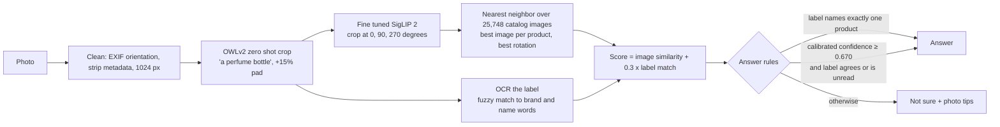
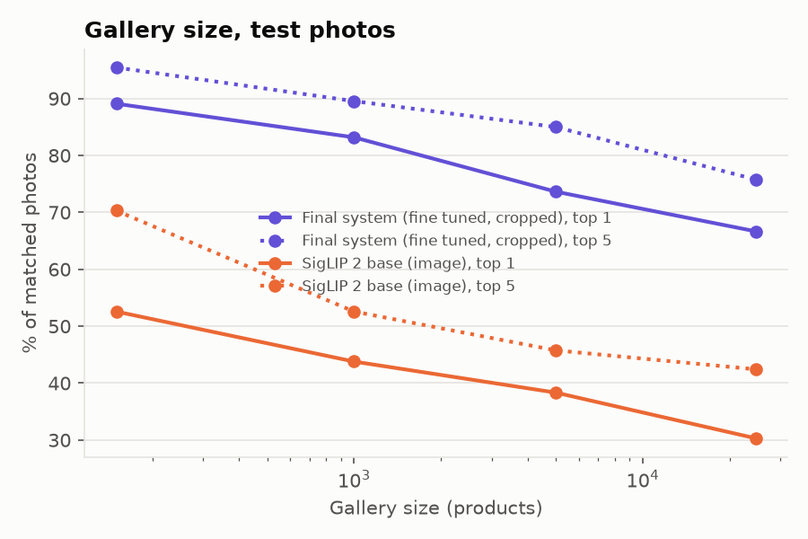
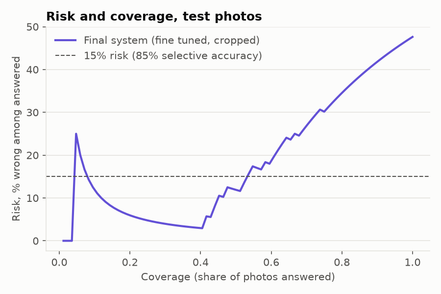

# ScentLens

ScentLens identifies a fragrance from a photo of its bottle by searching **24,642 catalog fragrances**, and it says "not sure" when it cannot tell.

**Demo:** [huggingface.co/spaces/bhnsadhu/scent-lens](https://huggingface.co/spaces/bhnsadhu/scent-lens) · **Use it from another app:** [docs/integration.md](docs/integration.md)

The research question, set before any real photo was scored ([preregistration](docs/experiments/preregistration.md)): how much does recognition fall from catalog shots to real phone photos, which conditions break it, and can the system tell when it is wrong?

## Headline

| | Top 1 | Top 5 | When it answers |
|---|---|---|---|
| Frozen SigLIP 2, real test photos | 30.3 [20.0, 43.3] | 42.4 | |
| **Version 1** (fine tuned + bottle crop), test scored once | **66.7** [54.8, 78.2] | 75.8 | answers 56% of photos, 83.0% correct |
| **Version 2** (+ rotations, label reading, answer rules), fresh web photos | **76.2** [56.6, 94.3] | 90.5 | answers 33%, **14 of 14 correct** |
| Version 2 on the test photos (seen before, so optimistic) | 71.2 | 80.3 | answers 36%, 28 of 30 correct |

- Fine tuning took real photo top 1 from 30.3 to 48.5. The bottle crop then took it to 66.7.
- In version 2, every wrong accepted answer on any set was a bottle that is **not in the catalog**, answered as a look-alike catalog sibling.
- Brackets are 95% bottle level bootstrap intervals. The sets are small, so read the numbers as estimates with wide uncertainty, not guarantees.

## How it works



- **Retrieval, not classification.** Each catalog image is embedded once. A product's score is its best matching image, so a new fragrance only needs a reference image and no retraining.
- **Fine tuning.** SigLIP 2 base (frozen) gets LoRA adapters (rank 8) on the attention q and v projections of its last 4 blocks, plus an identity initialized projection head.
  - Training is contrastive (symmetric InfoNCE, temperature 0.05).
  - Queries are augmented catalog images (glare, blur, low light, perspective, clutter, occlusion, JPEG) from about 8,000 products. Batches are built brand by brand, so products of the same brand act as hard negatives.
  - No real photo was used for training. Every product on the bottle list, and every product sharing a product line with one, was excluded, so the measured gains are conservative.
  - Training ran on a laptop GPU (Apple MPS). The setting (learning rate 1e-4, augmentation strength 1.0, epoch 1) was chosen from a grid of 4 runs on development photos ([runs.jsonl](results/runs.jsonl)).
- **Label reading.** The crop is read by OCR at the three rotations. Read words are fuzzy matched (rapidfuzz ratio ≥ 85) against each product's brand and name words, after generic words (concentrations, "pour homme", sizes, cities) are removed.
- **Answer rules** ([calibrator_v2.json](results/calibrator_v2.json)):
  - A logistic calibrator turns three features (top score, margin to second, brand agreement in the top 5) into a confidence.
  - The threshold is the lowest at which the development photos give a 95% upper bound on error of at most 10% (Clopper–Pearson).
  - A guard refuses when most of the words read do not belong to the guess.
  - A clear label rule answers when every brand and name word of exactly one product was read.
- **Latency:** 1.2 s per photo on an Apple M series GPU, and 2.5 s median on its CPU ([recognizer_rapidocr.md](results/recognizer_rapidocr.md)).

## Data

- **Catalog:** [doevent/perfume](https://huggingface.co/datasets/doevent/perfume) at revision 9d2db452, cleaned to 25,748 images of 24,642 products from 1,255 brands ([data_notes.md](docs/data_notes.md)). A product is a brand plus a normalized name, so concentrations of one fragrance count as one product.
- **Real photos:**
  - 63 bottles owned by the author and friends: 49 in the catalog and 14 confirmed absent.
  - 141 phone photos plus 44 audited online product images, taken under a fixed [protocol](docs/photo_protocol.md) (clean, angled, cluttered, partial).
  - Split by bottle into a development pool (27 bottles, 101 photos, 5 folds) and a test split (28 bottles, 84 photos).
- **Web set:** 42 openly licensed photos (Wikimedia Commons, and Flickr found through Openverse) of 32 catalog products. None was in training or on the bottle list, and none was used for any choice. Each was checked by eye, and none is a near copy of its own catalog images (the smallest perceptual hash distance is 14). Sources and licenses are in [web_sources.csv](results/web_sources.csv).

## Evaluation method

- The [preregistration](docs/experiments/preregistration.md) fixed the hypotheses, metrics and decision rules before evaluation, and a test keeps it frozen. Later changes are dated notes appended to it.
- Every choice was made on development photos with folds grouped by bottle: backbone, fine tune setting, crop, calibrator and threshold.
- The test split was scored **once** by [eval_test.py](scripts/eval_test.py), which refuses to run on a dirty tree or a second time ([test_lock.json](results/test_lock.json)).
- Version 2 came after that single test. Its test numbers are therefore optimistic, and the web set is the fresh check.
- Metrics:
  - Strict top 1 and top 5 (same product).
  - Lenient top 1 (same product line).
  - Selective accuracy and coverage. Photos of bottles not in the catalog count as wrong whenever they are answered.
- Intervals come from 2,000 bootstrap resamples over bottles.
- Every decision is logged with its reason in [decisions.md](docs/decisions.md).

## Results

### Version 1 test, scored once ([test_results.md](results/test_results.md))

66 photos of 21 matched bottles, plus 18 photos of 7 absent bottles.

| Method | Top 1 | Top 5 | Phone top 1 | Online top 1 |
|---|---|---|---|---|
| CLIP (text prompt) | 12.1 | 19.7 | 2.1 | 38.9 |
| SigLIP 2 (text prompt) | 28.8 | 42.4 | 12.5 | 72.2 |
| DINOv2 base | 31.8 | 48.5 | 18.8 | 66.7 |
| SigLIP 2 base | 30.3 | 42.4 | 10.4 | 83.3 |
| Fine tuned SigLIP 2 | 48.5 | 60.6 | 31.2 | 94.4 |
| **Fine tuned + crop** | **66.7** [54.8, 78.2] | **75.8** | **56.2** | **94.4** |

By condition (fine tuned + crop):

| Clean (18 photos) | Cluttered (18) | Angled (9) | Partial (3) | Online (18) |
|---|---|---|---|---|
| 66.7 | 66.7 | 33.3 | 0.0 | 94.4 |

Accuracy falls as the catalog grows: top 1 is 89.1 against 150 products and 66.7 against all 24,642.



### Version 2 ([v2_results.md](results/v2_results.md))

| Step | Dev top 1 | Test top 1 | Web top 1 | Test: answered, correct | Web: answered, correct |
|---|---|---|---|---|---|
| Version 1 | 53.1 | 66.7 | 59.5 | 56.0%, 83.0% | 47.6%, 85.0% |
| + rotations | 54.3 | 69.7 | 57.1 | 51.2%, 86.0% | 38.1%, 93.8% |
| + label reading and guard | 65.4 | 71.2 | 76.2 | 35.7%, 93.3% | 26.2%, 100% |
| **+ clear label rule (kept)** | **65.4** | **71.2** | **76.2** | **35.7%, 93.3%** | **33.3%, 100%** |

- Photos of bottles not in the catalog that were answered anyway: 5 of 18 in version 1, 2 of 18 in version 2.
- Reading the label at full resolution added 1.5 test points, but it answered with more errors (web: 85% correct), so the conservative variant was kept.



### Shipped recognizer, end to end ([recognizer_vision.md](results/recognizer_vision.md), [recognizer_rapidocr.md](results/recognizer_rapidocr.md))

The exported model was run from original photo files through [scent_lens.recognize](src/scent_lens/recognize.py).
- With the macOS Vision reader, its top match agrees with the evaluation on 100% of photos, with identical answers.
- The demo runs off macOS, so it uses RapidOCR with the same settings:

| Photos | Top 1 | Top 3 | Answered | Correct when answered |
|---|---|---|---|---|
| Development | 61.7 | 70.4 | 24.8% | 25 of 25 |
| Test | 71.2 | 74.2 | 28.6% | 22 of 24 |
| Web | 73.8 | 85.7 | 42.9% | 18 of 18 |

### Hypotheses (preregistered, version 1 test)

| Hypothesis | Outcome | Evidence |
|---|---|---|
| H1 Frozen image retrieval beats text prompts | Inconclusive | difference 1.5 [-10.0, 13.0] |
| H2 Real photos fall more than 15 points below synthetic | Supported | phone top 1 10.4 against 87.2 synthetic |
| H3 Damage order by condition | Not tested | no glare or dim photos were taken |
| H4 Top 5 stays above 50% at the full catalog | Supported | 75.8 |
| H5 Fine tuning gains at least 5 points | Supported | +18.2 [7.7, 29.2] |
| H6 Abstention reaches ≥ 85% selective accuracy at ≥ 25% coverage | Refuted (narrowly) | 83.0% at 56.0% |
| H7 Absent bottles are rejected more often (exploratory) | Supported | +35.9 [5.3, 65.1] |

Version 2's answer rules address H6. That is a post hoc result, not a preregistered one.

## What did not work, and limits

- **Look-alike flankers outside the catalog.**
  - Glossier You Fleur was answered as Glossier You.
  - Good Girl was answered as Good Girl Légère.
  - In both, the bottle is nearly identical and no label text was read. These were left as they are, because fixing them would mean tuning on test photos.
- **Rear views, side views and partial views** are rarely answered: angled top 1 is 33.3 and partial top 1 is 0.
- **Refitting the answer rules with RapidOCR** made label driven guesses on catalog siblings overconfident, and no threshold qualified. The shipped settings come from the macOS Vision fit. With RapidOCR, the 25 of 25 correct development answers fall short of the 29 that rule needs for its 95% bound.
- **Small samples.** There are 28 test bottles and 42 web photos, with one photographer, one home and two phones. The bottle list leans toward popular designer fragrances.
- **Label noise.** A bottle can differ from its catalog picture across release years.

Not measured: glare and dim light on real photos, photos with several bottles, other photographers or homes, and any user study.

## Use it

```python
from PIL import Image
from scent_lens.recognize import Recognizer

rec = Recognizer("artifacts/export")
rec(Image.open("bottle.jpg")).to_dict()
# {"answered": true, "reason": "confident", "confidence": 0.98, "product_id": "p19351",
#  "matches": [{"product_id": "p19351", "brand": "Prada", "name": "Paradoxe", ...}, ...], "seconds": 1.1}
```

The hosted demo exposes the same call as an API endpoint, `/identify`. [docs/integration.md](docs/integration.md) covers the fields, the reasons for abstaining, the stable product ids and the HTTP client.

## Reproduce

```bash
python -m venv .venv && .venv/bin/pip install -r requirements.txt   # exact versions: requirements-lock.txt
export PYTORCH_ENABLE_MPS_FALLBACK=1
.venv/bin/python scripts/download_data.py && .venv/bin/python scripts/clean_catalog.py
.venv/bin/python scripts/embed_catalog.py --backbone siglip2        # and dinov2, clip
.venv/bin/python scripts/finetune.py --backbone siglip2 --run siglip2_lr1e-4_s1.0
.venv/bin/python scripts/eval_v2.py                                 # version 2 (needs the private photos)
.venv/bin/python scripts/export_model.py && .venv/bin/python scripts/eval_recognizer.py
SCENTLENS_READER=rapidocr .venv/bin/python app/app.py               # demo
.venv/bin/pytest -q                                                 # CI runs the torch-free subset
```

The real photos are private, so the photo evaluations can't be rerun from this repo. Their ids, splits, per photo records and metrics are committed.

## Data and rights

- Rights to the doevent/perfume catalog images are unverified. No catalog image appears in this repo, its charts or the demo. The demo shows names only.
- This repo contains no photos.
- The Hugging Face Space holds the merged model, float16 catalog embeddings and product metadata derived from the dataset, plus six of the author's own photos shared with consent. A free Space sleeps when idle, so the first request can take a minute.
- Web test photos stay local. Their licenses (CC BY, CC BY-SA, some non-commercial or no-derivatives) are listed in [web_sources.csv](results/web_sources.csv).
- Base models: SigLIP 2 and OWLv2 (Google), DINOv2 (Meta), CLIP (LAION OpenCLIP). OCR: macOS Vision and RapidOCR.

## Related work

The catalog to real gap studied here is the setting of Zhang, Mazumder and Lomakin, *Bridging the Catalog-to-Real Gap: Scalable Product Recognition via Multi-Stage Contrastive Learning* (arXiv:2607.09888). That paper treats product recognition as retrieval from studio catalog images to real in-store crops.

## License

MIT for the code. Model weights follow their base models' licenses.
