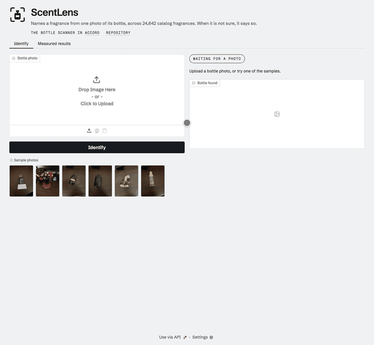
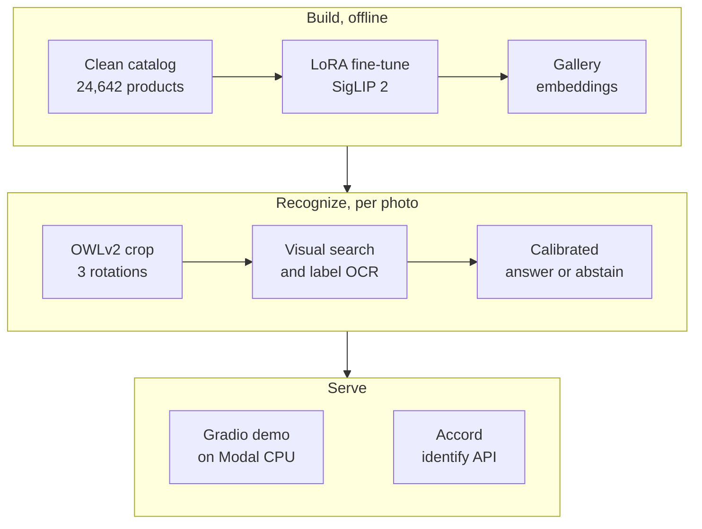

<p align="center"></p>

# ScentLens

**Point it at a perfume bottle and it names the fragrance from 24,642 catalog products, or says "not sure."** It is the recognition engine behind the bottle scanner in [Accord](https://accord.bhanusadhu.com).

**[Demo → scentlens.bhanusadhu.com](https://scentlens.bhanusadhu.com)** · free

> **The live demo is paused for now.** It runs on a free Modal plan whose monthly credit is used up, so the address shows a status page until the credit resets. The recording below shows the same flow.



## The problem

Catalog photos are clean studio shots, and a phone photo of a bottle on a cluttered desk looks nothing like them. Worse, many fragrances are flankers that share one bottle, so an image match can be confidently wrong, and a wrong name sends someone to the wrong fragrance.

ScentLens aims to **name the bottle when the evidence is strong and say "not sure" otherwise.**

## How it works

1. **Find and crop the bottle.** An open-vocabulary detector (OWLv2) boxes "a perfume bottle" and crops it. The crop is searched at three rotations.
2. **Match the look.** A SigLIP 2 image model, fine-tuned with LoRA on catalog images, embeds the crop and compares it with every catalog image.
3. **Read the label.** OCR reads the words on the bottle and adds a text-match score to the visual one, which separates look-alike siblings.
4. **Answer or abstain.** A calibrated confidence decides. When the label clearly names one product, or confidence clears a threshold set by a statistical bound, it answers. Otherwise it shows candidates and says it is not sure.

## Product decisions

| Decision | Trade-off |
| --- | --- |
| **Abstain rather than guess** | On version 2 test photos it answers fewer than a third, but 22 of the 24 it answered were right. For a lookup tool a wrong name costs more than a missing one. |
| **Write the hypotheses down first and score the test photos once** | Slower, and later ideas have to be reported as a separate "version 2" whose test numbers are optimistic. In return the headline number cannot have been tuned to the test photos. |
| **Search a gallery instead of training a classifier** | Near-identical sibling bottles stay hard to separate. A new fragrance needs only its image embedded, with no retraining. |
| **Swap the label reader instead of refitting around it** | The hosted version cannot use macOS Vision, so it uses RapidOCR. Refitting every setting for RapidOCR made guesses on look-alike siblings confident, so that refit was discarded and the reader was swapped with every other setting unchanged. |
| **Free CPU hosting on Modal** | One container that sleeps when idle, so the first photo waits for a cold start, and a free monthly credit that can run out, as it has now. |
| **Never loosen a safety filter after seeing results** | A strict explicit-image filter removed a whole product line, probably because of a stiletto-shaped bottle. Those products stay out of the catalog instead of the filter being tuned to bring them back. |

## Architecture



Everything runs on CPU in production. The exported bundle holds the fine-tuned model with its LoRA weights merged, the gallery embeddings and the calibrated settings, loaded by one Python class, `Recognizer`. Accord calls the same function over HTTP. See [docs/integration.md](docs/integration.md) and [src/scent_lens/recognize.py](src/scent_lens/recognize.py).

## Hard problems

**Studio shots versus real photos.** The frozen SigLIP 2 model scored **30.3%** top-1 on the held-out test photos. Fine-tuning lifted it to **48.5%**, and cropping to the bottle first, so the model sees a bottle and not a desk, lifted the final system to **66.7%**. On development photos the crop raised cluttered-scene top-1 from **12.5% to 58.3%**. See [src/scent_lens](src/scent_lens) and [results/test_results.md](results/test_results.md).

**Knowing when it doesn't know.** The answer threshold is the lowest confidence at which the 95% upper bound on error stays at or below 10%. That is a strict requirement for a small photo set: 22 correct answers with no error give an upper bound of 12.7%, and 29 are needed. At first no threshold qualified and the system always abstained. After the crop, the threshold of 0.641 answered 33 of 101 development photos, all correct, and refused all 20 photos of bottles not in the catalog. See [src/scent_lens/calibration.py](src/scent_lens/calibration.py).

**Look-alike siblings.** Flankers often share a bottle shape. Reading the label and adding a weighted text-match score raised development top-1 from **54.3% to 65.4%**. The two wrong answers among the hosted system's 24 answered test photos are both photos of bottles that are not in the catalog, answered as a catalog sibling: Glossier You, and Carolina Herrera Good Girl Eau de Parfum Légère. They are documented, not tuned away on test photos.

**Making the shipped model match the evaluation.** The first end-to-end run of the exported model disagreed with the evaluation on **7%** of top matches even though the weights were identical. The evaluation had scored crops that were saved as JPEG and read back, while the app used the crop in memory. Once the pipelines matched, the exported system's top-1 agreed with the evaluation on 92.9% to 97.6% of photos in each pool.


## Results

All searches use the full catalog of 24,642 products. Brackets are 95% intervals from resampling bottles, and the photo sets are small.

| Photos | Top-1 | Top-5 | Answered | Correct when answered |
| --- | --- | --- | --- | --- |
| Test, version 1, pre-registered and scored once (84 photos, 28 bottles) | **66.7%** [54.8, 78.2] | 75.8% | not the shipped threshold | |
| Test, version 2 as shipped (seen once already, so optimistic) | 71.2% | 74.2% (top 3) | 24 of 84 | **22 of 24** |
| Web photos, version 2 as shipped (42 openly licensed, never used for any choice) | 73.8% | 85.7% (top 3) | 18 of 42 | **18 of 18** |

- **65 unit tests** (calibration bounds, crop geometry, retrieval ranks, metrics, splits, OCR matching, and a test that pins the SHA-256 of the pre-registration so its original text cannot be edited), run with ruff lint in CI.
- **Hypotheses, version 1:** fine-tuning gain of at least 5 points was supported (18.2). Gallery size mattered (supported). Abstention reaching 85% accuracy at 25% coverage was **refuted**: at the version 1 threshold it answered 56.0% of photos at 83.0% accuracy.
- **Latency:** a median of 2.45 s and 3.12 s at the 90th percentile per photo on CPU, and about 6 s per photo on 4 cloud cores once awake.
- **Photos:** 55 bottles photographed by me and friends (141 phone photos plus 44 online product images), split by bottle into 27 development and 28 test bottles, with 7 test bottles not in the catalog.

**Not measured:** accuracy on bottles photographed by strangers, behavior on glare and dim light (no such phone photos were taken), and speed on phones.

## How it was built

1. **Clean the data.** 26,283 catalog images became 25,748 images of 24,642 products: duplicates and brand-generic pictures removed, rows grouped into products, explicit images filtered.
2. **Pick a backbone.** CLIP, DINOv2 and SigLIP 2 were compared on synthetic distortions, then on real development photos.
3. **Pre-register, then tune.** Hypotheses and rules were frozen before any real photo was scored, then the fine-tune settings, the crop and the calibrator were chosen on development photos only.
4. **Score the test once.** Version 1 was scored a single time, and one hypothesis came back refuted.
5. **Version 2 and shipping.** Rotations, label reading and a fresh web set came after the test, then the model was exported, hosted on Modal and connected to Accord.

## Tech stack

| Layer | Technology |
| --- | --- |
| Models | SigLIP 2 fine-tuned with LoRA, OWLv2 detector, PyTorch |
| Label reading | macOS Vision in development, RapidOCR on ONNX Runtime when hosted |
| Evaluation | scikit-learn calibration, Clopper-Pearson bounds, Matplotlib |
| App and hosting | Gradio on Modal free tier (CPU), deployed by GitHub Actions |
| Testing | pytest, ruff |

## Run it locally

```bash
uv venv && source .venv/bin/activate
pip install -r requirements.txt
pytest -q                                 # unit tests
python scripts/download_data.py           # catalog metadata and images
python scripts/export_model.py            # bundle the model, gallery and settings
python app/app.py                         # the demo, locally
```

`Recognizer("artifacts/export")` identifies a photo from Python, and [docs/integration.md](docs/integration.md) shows the HTTP route. Pushes to `main` that touch the demo redeploy it on Modal.

## Project structure

```text
src/scent_lens/   catalog cleaning, crop, embedding, fine-tune, retrieval, OCR, calibration, recognize
scripts/          data download, embedding, training, evaluation, export
app/              the Gradio demo
deploy/           Modal app and brand assets
tests/            unit tests on toy fixtures
results/          every reported number, with its JSON and charts
docs/             plan, decisions, pre-registration, integration
```

## What's next

**Known limits**

- It only knows catalog fragrances, and the source catalog ends in early 2024.
- Front views with a readable label are answered most. Rear views, side views and hands covering the bottle rarely are.
- One bottle per photo, and the photo sets are small, so the intervals are wide.
- The live demo depends on a free monthly credit.

**Next:** more real photos to tighten the intervals, and a test set photographed by people outside this project.

[Plan](docs/PLAN.md) · [Decisions](docs/decisions.md) · [Pre-registration](docs/experiments/preregistration.md) · [Integration](docs/integration.md) · [Measured results](app/results.md)
